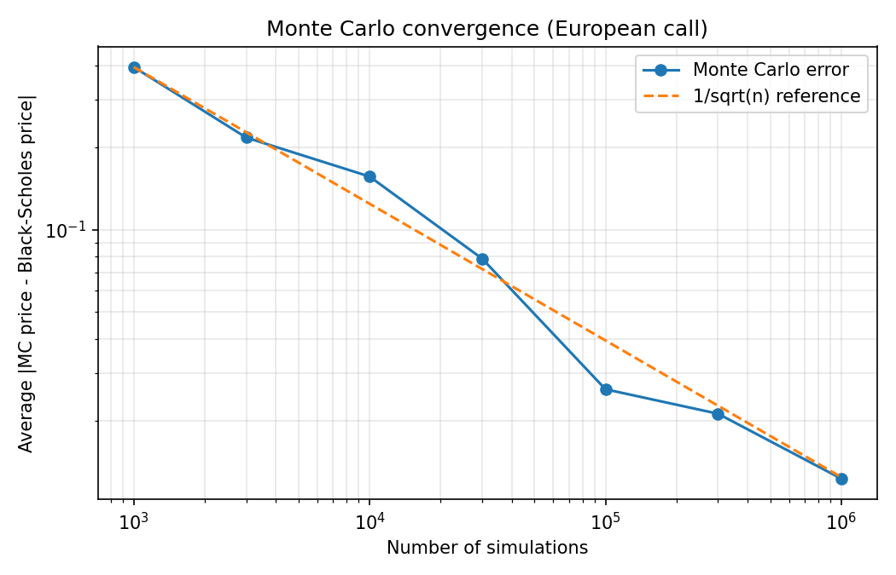
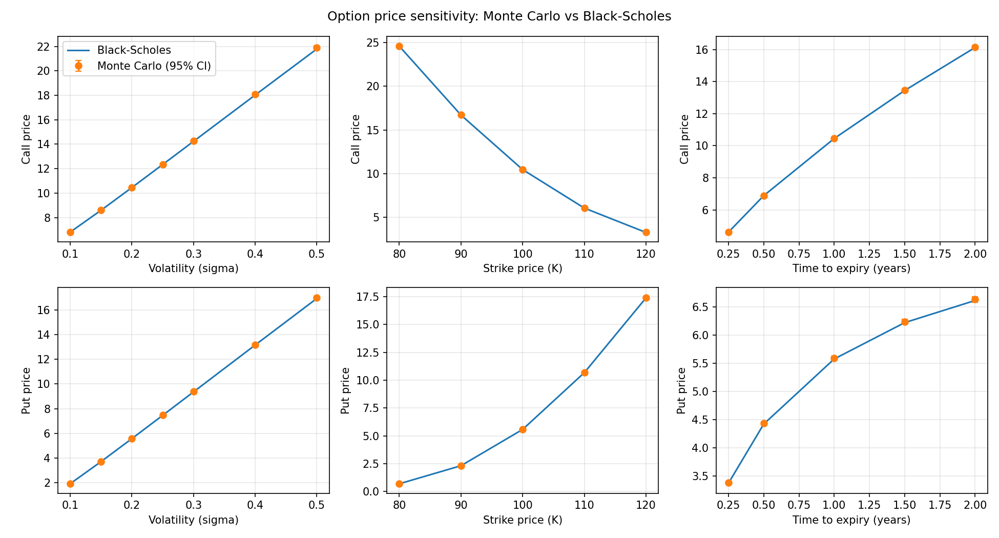
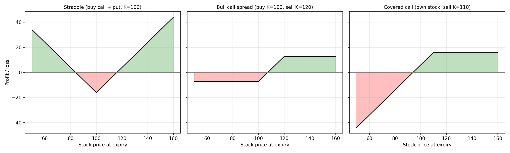

# Monte Carlo Option Pricing & Strategy Analysis

Prices European call and put options two ways, with a **Monte Carlo simulation**
and with the **Black-Scholes formula**, then compares them and uses the simulator
to analyse option strategies.

**Stack:** Python, NumPy, Pandas, SciPy, Matplotlib

## Idea in short
An option's fair price is the expected payoff at expiry, discounted to today.
- **Monte Carlo:** simulate many possible future stock prices using Geometric
  Brownian Motion, average the payoffs, discount.
- **Black-Scholes:** exact closed-form price (used to validate the simulator).

Base case used throughout: S0 = 100, K = 100, T = 1 year, r = 5%, sigma = 20%.

## Project structure
| File | Purpose |
|---|---|
| `payoffs.py` | Call and put payoff functions |
| `gbm.py` | Simulates terminal stock prices with Geometric Brownian Motion |
| `monte_carlo.py` | Monte Carlo pricer (returns price and standard error) |
| `black_scholes.py` | Analytical Black-Scholes price |
| `step5_convergence.py` | Error vs number of simulations |
| `step6_sensitivity.py` | Price vs volatility, strike and time to expiry |
| `strategies.py`, `step7_strategies.py` | Straddle, bull call spread, covered call |

## How to run
```
python3 -m venv venv
source venv/bin/activate
pip install -r requirements.txt
python3 step4_test.py
python3 step5_convergence.py
python3 step6_sensitivity.py
python3 step7_strategies.py
```

## Results

### 1. Monte Carlo matches Black-Scholes
With 100,000 simulations, Monte Carlo prices fall within their 95% confidence
interval of the exact price in every tested case.

| Sigma | Type | Black-Scholes | Monte Carlo |
|---|---|---|---|
| 0.2 | Call | 10.451 | 10.421 |
| 0.2 | Put | 5.574 | 5.612 |

Put-call parity also holds: call - put = S0 - K*exp(-rT) = 4.877.

### 2. Convergence
The average error shrinks at the theoretical 1/sqrt(n) rate: 0.39 at 1,000
simulations, 0.026 at 100,000 and 0.012 at 1,000,000. Making the error 10x
smaller needs about 100x more simulations.



### 3. Sensitivity to inputs
Varying one input at a time (Monte Carlo vs Black-Scholes):
- Higher volatility raises both call and put prices.
- Higher strike lowers call prices and raises put prices.
- Longer time to expiry raises call prices; put prices also rise but flatten out.



### 4. Strategy analysis
Profit diagrams, plus Monte Carlo statistics over 200,000 simulated outcomes:

| Strategy | Cost | Probability of profit | Worst case | Best case |
|---|---|---|---|---|
| Straddle | 16.02 | 43.0% | -16.02 | 164.49 |
| Bull call spread | 7.20 | 42.1% | -7.20 | 12.80 |
| Covered call | 93.96 | 67.7% | -55.50 | 16.04 |

A high win rate does not mean a better strategy: the covered call wins most
often but its profit is capped and its downside is large.



## Limitations
- Black-Scholes assumes constant volatility, a constant interest rate and no dividends.
- Only European options are priced.
- Simulations use the risk-neutral drift (r), so probabilities of profit are
  model-based, not forecasts of real markets.
- Strategy profits ignore interest on the upfront cost.